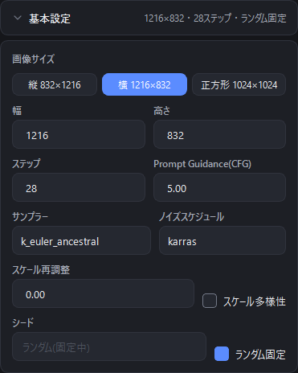
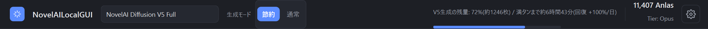
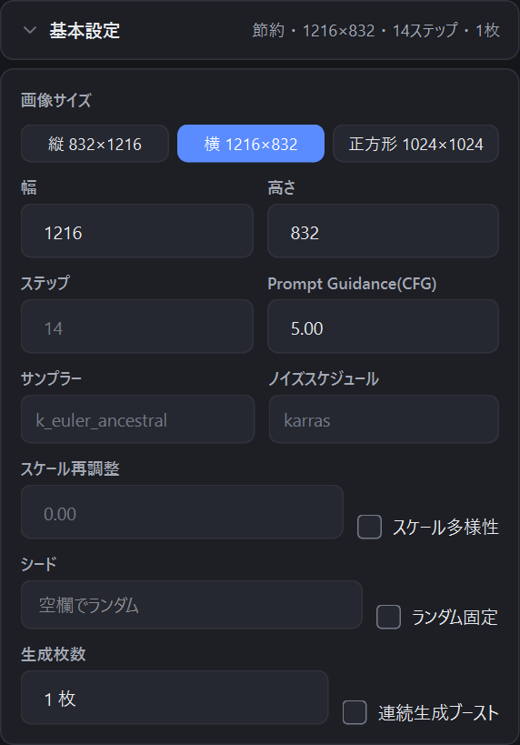
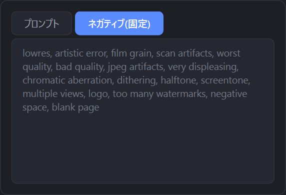

# 2. 画像を生成する

[目次に戻る](README.md)

## 基本の流れ

1. 画面上部でモデルを選びます(NovelAI Diffusion V5 / V4.5 / V4 / V3)。
2. 左上の「プロンプト」の中の「プロンプト」タブにプロンプトを、「ネガティブ」タブにネガティブプロンプトを入力します。
   見出しの「プロンプト」を押すと、全体を折りたためます(畳んでいても、見出しにプロンプトの冒頭が表示されます)。
3. 「基本設定」で画像サイズなどを決めます。
4. 中央下の見積り(消費 Anlas)を確認し、生成枚数を決めて、「生成」を押します。

生成した画像は中央のプレビューに表示され、設定した保存先に自動で保存されます。
画像には NovelAI と同じ形式で生成設定が埋め込まれます。

## タグの入力補完

プロンプトの入力中に、タグの候補が表示されます。
V5 は文章でのプロンプトにも対応しているため、自動では候補を出しません。V5 で候補を出したいときは `Ctrl + Space` を押してください(ほかのモデルでも使えます)。

## 基本設定

| 項目 | 内容 |
|---|---|
| 画像サイズ | 「縦 832×1216」「横 1216×832」「正方形 1024×1024」から選ぶか、幅・高さを直接入力します(64 の倍数) |
| ステップ | 生成のステップ数 |
| Prompt Guidance(CFG) | プロンプトにどれだけ従うか |
| サンプラー / ノイズスケジュール | 生成方式 |
| スケール再調整 / スケール多様性 | NovelAI の同名の設定と同じです |
| シード | 空欄なら毎回ランダム。数字を入れると同じシードで生成します |
| ランダム固定 | オンの間はシードを空欄(毎回ランダム)に固定します。画像から設定を読み込んでも、シードは読み込みません |

## 生成枚数と連続生成ブースト

「生成枚数」と「ブースト」は、中央下の見積りの横(「キューに追加」「生成」の左)にあります。どちらも、「キューに追加」と「生成」の両方に効きます。

- **生成枚数**: 1〜16 枚です。
- **ブースト**(連続生成ブースト):
  - **オフ**: 1 枚ずつ生成を繰り返します。Opus の無料枠の条件を満たせば、毎回無料になります。
  - **オン**: NovelAI の同時生成(公式サイトと同じ)で、複数枚をまとめて生成します。速くなりますが、Opus の無料枠が効くのは 1 回のリクエストにつき 1 枚分だけです。
    1 回に同時生成できる枚数には画像サイズごとの上限(通常のサイズは 4 枚)があり、超える分は自動で分けて送ります。

## 生成モード(V5 の「節約」)

NovelAI Diffusion V5 Full を選ぶと、画面上部のモデルの隣に「生成モード」が表示されます。

| | 節約 | 通常 |
|---|---|---|
| 生成方法 | 14 ステップの高速モデル | これまでどおり |
| 消費 Anlas | 少ない(832×1216 で 17 Anlas。通常の 23 ステップは 26 Anlas) | これまでどおり |
| Opus の利用上限(V5 生成の残量) | 減りが小さい(NovelAI の説明) | これまでどおり |

「節約」にすると、サーバー側で次の設定が**固定**され、変更できません(画面では固定値が薄く表示されます)。

- ステップ(14)、サンプラー(Euler Ancestral)、ノイズスケジュール、スケール再調整
- ネガティブ(「ヘビー」という標準の文言に固定。キャラクターごとのネガティブも使われません)

固定される設定は、NovelAI のサーバーが無視します。そのためこのアプリでは、「節約」のときは入力欄を使えないようにしています。
「通常」に戻すと、節約にする前の値(ステップ、ネガティブなど)に戻ります。

プロンプトの重み付けと、Prompt Guidance(CFG)、スケール多様性は「節約」でも使えます。
除外したいものは、プロンプトに `-3::帽子::` のように書くと効きます(帽子が描かれなくなります)。

Opus で 832×1216 などの標準サイズ(1 リクエストにつき 1 枚)なら、「節約」「通常」のどちらも Anlas は 0 です。
標準サイズより大きい画像や、同時生成の 2 枚目以降は、「節約」のほうが安くなります。
画像から設定を読み込むと、生成モード(節約 / 通常)も読み込まれます。

## Anlas 残高の表示

画面上部に、Anlas の残高が「有料」と「無料」に分けて表示されます。マウスを乗せると、合計と次の説明が表示されます。

- 有料: 購入した Anlas(なくなるまで残ります)
- 無料: サブスクリプションに含まれる Anlas(毎月付与されます)

生成や後処理の間は、左上のロゴと「生成」ボタンのアイコンが回転します。

## 消費 Anlas の見積り

中央下に、送信する前の消費 Anlas の見積りが表示されます。見積りは NovelAI 公式サイトと同じ計算方法に合わせていますが、目安であり、実際の消費量と異なる場合があります。

- **Opus の無料枠**: 画像サイズが 1024×1024 ピクセル以下(832×1216 など)で、ステップが 28 以下なら、1 枚分が無料になります。
- **Precise Reference**: 参照画像 1 枚につき、生成 1 枚あたり 5 Anlas が追加でかかります。
- **Opus の V5 生成の残量**: Opus で V5 を使うと、画面上部に残量と、満タンになるまでの目安時間が表示されます。

## 結果の一覧

今回生成した画像は、プレビューの下に小さく並びます。選んだ画像がプレビューに表示され、後処理の対象になります。

一覧の右の「保存先を開く」を押すと、画像の保存先のフォルダがエクスプローラーで開きます(日付ごとのフォルダを使っているときは、今日のフォルダ。まだ作られていないときは、その親の保存先です)。

## 画像から設定を読み込む

NovelAI で生成した画像(このアプリや公式サイトで生成したもの)をウィンドウにドラッグ&ドロップすると、画像に埋め込まれた設定(プロンプト、サイズ、サンプラー、キャラクターなど)を読み込みます。
対応形式は PNG / JPG / WEBP / BMP です。「ランダム固定」がオンのときは、シードだけは読み込みません。

次は [キャラクターと配置](03-characters.md) です。
